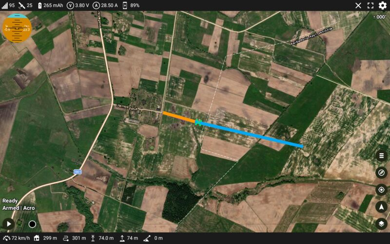
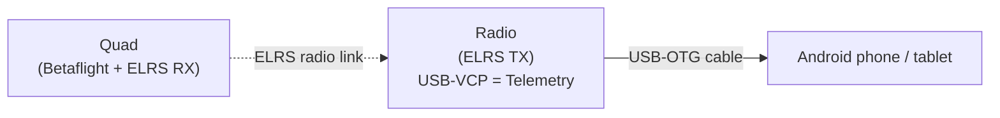
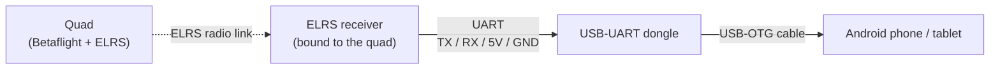
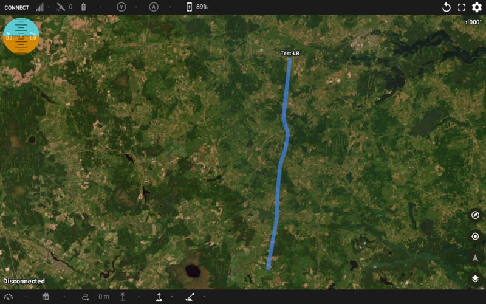
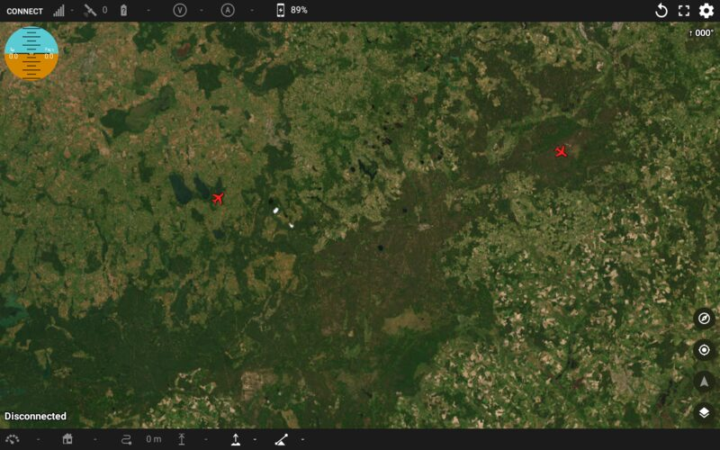
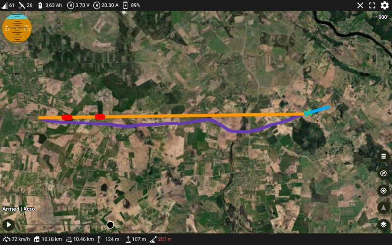

# Android Taranis SmartPort Telemetry

An Android app for following a Betaflight quad's telemetry live on a phone or tablet. It shows
the quad's position on a satellite or topographic map, along with its altitude, speed, distance
from home, battery and link quality. Every flight is recorded so it can be replayed later or
exported to GPX/KML. With an offline terrain pack it also knows the ground under the quad: it
shows the height above ground, and how high the quad has to stay to keep a clear radio line of
sight back to the pilot. The app is used and tested with CRSF (ExpressLRS). The MAVLink
decoder is still in the code but is not tested and may not work. The FrSky SmartPort and LTM
decoders have been removed.

## Hardware setup

The phone gets the telemetry over a USB-OTG cable, in one of two ways.

### Through the radio (USB-VCP)

The quad's telemetry already reaches the radio over its ELRS link. EdgeTX/OpenTX radios can
pass it on through their USB port:

1. On the radio, set **SYS > Hardware > USB-VCP** to **Telemetry** (shown as *Telemetry
   Mirror* on some firmware versions).
2. Connect the radio's USB port to the phone with a USB-OTG adapter and cable. A plain
   USB-C to USB-C cable may not work; an OTG adapter plus a cable does.
3. In the app, tap **Connect** and choose the USB device.

### Through a ground ELRS receiver (USB-UART dongle)

Without a radio that can mirror telemetry, an ELRS receiver bound to the quad can be used on the
ground, connected to the phone through a USB-UART dongle (CP2102, CH340, FTDI...):

1. Bind an ELRS receiver to the quad.
2. Wire it to the dongle: receiver **TX** to dongle **RX**, receiver **RX** to dongle **TX**,
   **5V** and **GND**.
3. Plug the dongle into the phone with a USB-OTG cable.
4. In the app, set **Settings > USB Serial > Baudrate** to the receiver's serial speed (420000 for
   CRSF by default), then tap **Connect** and choose the USB device.

Bluetooth and BLE modules (HC-05, HC-06, HM-10, radios with built-in Bluetooth) are also
supported; see the [original README](https://github.com/CrazyDude1994/android-taranis-smartport-telemetry)
for wiring them.

## Features

- **Live map:** OpenStreetMap, OpenTopoMap, ESRI satellite and satellite + streets, all without
  API keys and cached for offline use. It shows the track, heading line and home line.
- **Readouts:** satellites, battery (mAh, voltage, cell voltage, current), speed, vertical
  speed, altitude, altitude above sea level, distance to home, travelled distance, throttle, artificial
  horizon, flight mode and armed state, CRSF link quality (RSSI, LQ, SNR, RF mode, TX power,
  active antenna), RC channels and telemetry rate. Each readout can be moved between the top and
  bottom bars or hidden.
- **Recording and replay:** every flight is logged (raw `.tlm` and CSV) and can be replayed with
  a seek bar, renamed, deleted or exported to GPX and KML.
- **Flight plans:** import CSV files (`lat,lon` per line) to draw planned routes on the map,
  with the name of each plan shown next to it. Several plans can be shown at once and toggled
  in the settings.

  

- **Nearby aircraft (FlightRadar24):** the app fetches real aircraft around the phone from
  FlightRadar24 (an internet connection is needed) and draws them on the map. When an aircraft comes close
  to the drone (within 5 km and below 1500 m by default), a voice warning gives its direction,
  distance and altitude: "Traffic, north-east, 3.2 kilometers, altitude 900 meters". The search radius, ceilings, warning distance and refresh rate are
  set in **Settings > FlightRadar24 Nearby Aircraft**; it is off by default.

  

- **Voice messages** for connection changes, and **automatic reconnection** over Bluetooth.

### Terrain: height above ground and line of sight

Given a terrain pack (an offline elevation model with tree and building heights, see
[doc/terrain.md](doc/terrain.md)), the app adds terrain readouts:

- **Height above ground:** the quad's height above the ground right below it, not above the
  takeoff point. It turns red above the height limit (120 m by default).
- **Altitude limit:** the altitude reading at which the quad reaches that limit over the current
  ground.
- **Ground elevation**, and **elevation with trees and buildings**, below the quad.
- **Minimum line-of-sight altitude:** the lowest altitude at which the radio link to the
  pilot's antenna keeps 60% of the first Fresnel zone clear of terrain, trees and buildings
  (5.8 GHz, 2.4 GHz or 900 MHz, selectable). Earth curvature is included. Below it, the readout
  turns red and the obstructed stretches of the home line are drawn in red on the map:

Here the quad is 10 km out at 124 m, but the link needs 207 m: two stretches near the pilot
(the red marks on the home line) cut into the Fresnel zone.

## Credits

This is a fork of [RomanLut's version](https://github.com/RomanLut/android-taranis-smartport-telemetry)
of CrazyDude1994's [Android Taranis SmartPort Telemetry Viewer](https://github.com/CrazyDude1994/android-taranis-smartport-telemetry).
Thanks to everyone who contributed to them, and to the
[usb-serial-for-android](https://github.com/mik3y/usb-serial-for-android) and
[osmdroid](https://github.com/osmdroid/osmdroid) projects.
