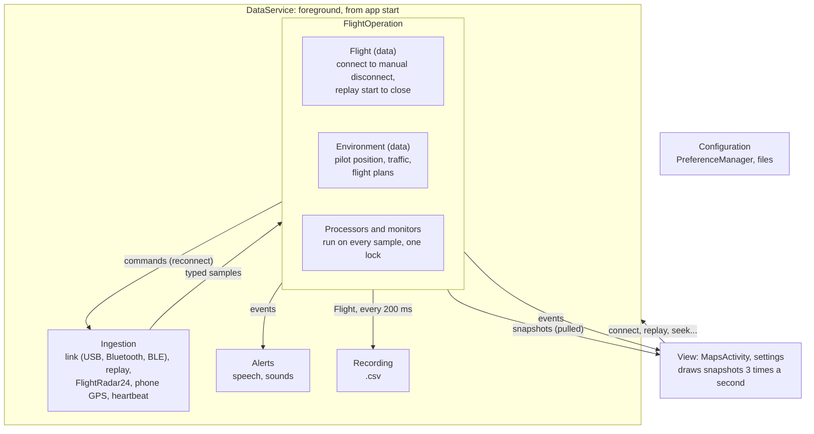
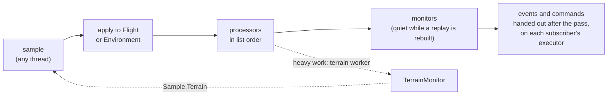

# Architecture

The app is four modules. **Ingestion** turns links and feeds into typed samples. The
**FlightOperation** holds what is known now and derives everything else. **Outputs** show,
speak and record it. **Configuration** holds the settings. Everything but the screens runs in
one foreground service, `DataService`, from app start until it is stopped from its
notification. So traffic warnings, reconnection and logging go on with the app closed.



## Modules and where they are in the code

| Module | Package | Main classes |
| --- | --- | --- |
| Ingestion | `ingestion`, `protocol`, `protocol.pollers` | `SampleAssembler`, pollers (`UsbDataPoller`, `BluetoothDataPoller`, `BluetoothLeDataPoller`, debug `FileDataPoller`), `ProtocolDetector`, `CrsfProtocol` and decoders, `ReplaySession` (with `LogPlayer`), `Fr24Source`, `PilotLocationSource` |
| FlightOperation | `operation` | `FlightOperation`, `Flight`, `Environment`, `Sample`, `Event`, `Command`; `operation.processors`, `operation.monitors` |
| Outputs | `output`, `ui` | `Alerts`, `CsvRecorder`; `MapsActivity`, `PrefsFragment` (the View) |
| Configuration | `manager` | `PreferenceManager`, `FlightPlanManager`, terrain packs (`terrain`) |
| Host | `service` | `DataService` |

The raw `.tlm` log is a dump of the link's bytes, so the pollers write it as part of Ingestion,
through `RcFrameThrottle`, which keeps 5 RC channel frames a second by default.

## Ingestion

Ingestion hands the FlightOperation **typed samples, never raw bytes** (`Sample`):

| Sample | From |
| --- | --- |
| `Telemetry(frame)` | the decoders, through `SampleAssembler`: every value of a batch of bytes in one `TelemetryFrame` |
| `Track(positions, replace)`, `Restart` | a replay step, or a replay played again from its start |
| `Link(status)`, `Protocol(name)` | the link: connected, failed, lost, or disconnected by the user |
| `Traffic(aircraft)` | `Fr24Source`, every poll interval, from app start |
| `PilotPosition(position)` | `PilotLocationSource` (the phone's GPS) |
| `FlightPlans(plans)` | `DataService.reloadFlightPlans()` |
| `Terrain(state)` | the terrain calculation's worker, sending its result back |
| `Heartbeat(now)` | `DataService`, once a second |

`SampleAssembler` gathers the decoders' value-by-value callbacks until the poller's `commit()`,
which comes after each batch of bytes read. A frame's values are decoded together when its last
byte arrives, so a commit never splits a frame: no processor sees a new latitude with an old
longitude.

## FlightOperation

`FlightOperation` lives as long as the service. It owns:

- the **Environment** (pilot position, traffic, flight plans): plain data, not stored in logs;
- at most one **Flight** at a time, live or replay, also plain data. A live flight lasts from
  connecting to a manual disconnect or app kill; a lost link does not end it. A replay flight
  lasts from starting the replay to closing it;
- the **processors**, which derive values, and the **monitors**, which raise events and
  commands.

Every sample goes through one pass, under one lock, because samples come from several threads:



| Processor | Derives |
| --- | --- |
| `TrackProcessor` | position, track (positions with a GPS fix), travelled distance, a replay's home (its first fix) |
| `FreshnessProcessor` | when each value last arrived, which ones are stale (10 s), the telemetry rate |
| `TerrainProcessor` | feeds the terrain calculation (`TerrainMonitor`, own worker thread): aircraft position, altitude, armed state, antenna (pilot, or a replay's home) |

| Monitor | Raises |
| --- | --- |
| `LinkMonitor` | connection events; after a lost link, `Command.Reconnect` 5 s later and after each failure, until 21 s |
| `AircraftMonitor` | `Event.TrafficWarning` for the closest aircraft in range, on each traffic update, live flights only |

Rules for adding one:

- **A processor** returns at once for samples it ignores. If it is heavy, it compares its
  inputs and hands real work to a worker, whose result comes back as a sample.
- **A monitor** is edge-triggered and keeps its own memory, so frequent calls never repeat an
  alert. It notices absences (a silent link, a stale contact) on the heartbeat.
- Both are registered in `DataService.onCreate()`, the only place the wiring is done.
- Neither may call out of the module directly: they emit events and commands.

## Outputs

- **View** (`MapsActivity`) binds to the service. It pulls snapshots of the Flight and the
  Environment 3 times a second, or 20 while a replay plays or its seek bar is dragged, and draws
  them in `render()`. It subscribes to events for toasts and its connected or idle state. It
  sends commands: connect, disconnect, start, seek or close a replay. A screen made again
  (rotation) takes up whatever the service is doing.
- **Alerts** speaks traffic warnings and plays the connection sounds, from the events, with or
  without a screen.
- **Recording**: `CsvRecorder` writes a row every 200 ms from the Flight, in the app's
  long-standing CSV format.

## Configuration

`PreferenceManager` gives typed access to the settings. Modules read the current value when they
use it, so most changes apply at once; the baud rate and RC log rate apply at the next
connection. FlightRadar24 on/off is followed through a settings listener in the service. Flight
plans and the terrain pack are reloaded when the map screen comes back from the settings.

## Threads

| Thread | Runs |
| --- | --- |
| main | the View, replay seeking, `TerrainMonitor` calls, the heartbeat |
| link reader (one per link) | reading, the raw log, decoding, the samples of the link |
| terrain worker | ground lookups and line-of-sight profiles |
| FR24 | fetches at the poll interval |
| `csv` | CSV rows |
| alerts executor | speech and sounds |

The FlightOperation has no thread of its own: a pass runs on the thread that submitted the
sample, under the lock.

## Tests

The tests follow the testing pyramid:

| Level | Where | Run with | What |
| --- | --- | --- | --- |
| Unit (most) | `app/src/test/.../operation`, `ingestion`, `output`, `protocol`, `logger`, `manager`, `terrain` | `./gradlew :app:testDebugUnitTest` (with `JAVA_HOME` = JDK 11) | each class alone |
| Integration | `app/src/test/.../integration` | same | CRSF bytes through the real protocol, assembler, flight operation, processors and monitors; the throttled log; CSV rows |
| End-to-end | `app/src/androidTest/.../e2e` | see below | on a device: replay through the service, the debug file link as a live flight (link lost, reconnection, disconnect), the flight without a screen, the real receiver on USB |

The end-to-end tests need a logged flight with GPS on the device, chosen with `-e log <part of
its name>`. The USB test runs only when an adapter is plugged in and permitted, and is skipped
otherwise. Run them without uninstalling the app, which `connectedDebugAndroidTest` does
afterwards, settings included:

```
./gradlew :app:installDebug :app:installDebugAndroidTest
adb shell am instrument -w -e log 2026-11-02 \
    jauler.com.telemetry.debug.test/androidx.test.runner.AndroidJUnitRunner
```

## Debug tools (debug builds)

- **A log as a live link:**

  ```
  adb shell am broadcast -a jauler.telemetry.debug.LINK --es cmd connect --es file "<name>.tlm" --ei duration 120 [--ei from <percent>]
  adb shell am broadcast -a jauler.telemetry.debug.LINK --es cmd drop|reconnect|disconnect
  ```

- **A replay at start-up:**

  ```
  adb shell am start -n jauler.com.telemetry.debug/crazydude.com.telemetry.ui.MapsActivity --es debug_replay "<name>.tlm"
  ```

- **Terrain inputs and outputs:** logged under the `TerrainState` tag.
